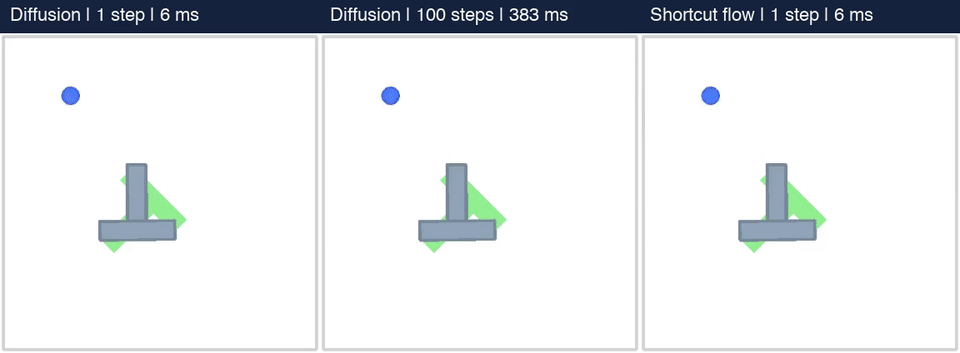

# FlowPolicy

Diffusion Policy with the DDPM objective replaced by flow matching, built as a [LeRobot](https://github.com/huggingface/lerobot) 0.6.1 plugin and evaluated on PushT. The goal is Diffusion Policy's accuracy at 1–4 network passes per action chunk instead of 100, which means far lower latency.



## Results (full-size models, PushT)

Three training seeds, 50 evaluation episodes each (eval seed 100000, same initial states for every policy). Mean ± std over seeds. Latency per action chunk was measured on a shared RTX 4090, so treat it as approximate. Policies with the same number of passes cost the same, because they share one U-Net. Re-running an identical configuration on another GPU moved success by up to 4 points, so gaps under about 5 points are noise.

### Headline

| Passes | Diffusion (ε-prediction, standard) | Diffusion (x0-prediction) | Flow | Best flow variant |
|---|---|---|---|---|
| 1 (~13 ms) | 0.0 | 50.7 ± 4.2 (DDIM) | 41.3 ± 4.2 | **55.3 ± 5.0** (shortcut) |
| 2 (~21 ms) | 47.3 ± 13.6 (DDIM) | 45.3 ± 2.3 (DDIM) | 46.7 ± 3.1 | **57.3 ± 3.1** (reflow) |
| 4 (~39 ms) | 55.3 ± 2.3 (DDIM) | 53.3 ± 5.0 (DDPM) | 55.3 ± 6.4 | 55.3 ± 3.1 (reflow) |
| 100 (~830 ms) | **60.7 ± 2.3** (DDPM) | 42.0 ± 4.0 (DDPM) | 60.7 ± 8.3 | 62.7 ± 4.2 (shortcut) |

- **The 2-pass result is the clearest win.** Reflow gets 57.3% at about 21 ms per chunk. That is +10 points over either Diffusion variant at the same cost, and within 3.4 points of 100-pass Diffusion at about 1/40 of the latency.
- **At 1 pass the comparison is closer than it first looked.** Standard Diffusion's 0% is an artifact of ε-prediction: an x0-prediction Diffusion model gets 50.7% at 1 pass. Shortcut (55.3%) leads it by less than the noise level, so "Flow beats Diffusion at 1 pass" is not established.
- x0-prediction Diffusion gets *worse* with more steps (42% at 100). At 1–2 steps it is good; at many steps it is the weakest variant.

### All full-size variants

| Method | Passes | Success % | Coverage |
|---|---|---|---|
| Diffusion, DDPM / DDIM (ε) | 100 | 60.7 ± 2.3 / 58.0 ± 8.7 | 0.922 / 0.945 |
| Diffusion, DDPM / DDIM (ε) | 1 | 0.0 / 0.0 | 0.156 |
| Diffusion, DDPM / DDIM (x0) | 1 | 40.7 ± 6.4 / 50.7 ± 4.2 | 0.908 / 0.881 |
| Flow | 1 | 41.3 ± 4.2 | 0.903 |
| Flow + 40k extra steps (control for shortcut) | 1 | 47.3 ± 2.3 | 0.924 |
| Shortcut (Flow + step-size conditioning, 40k fine-tune) | 1 | 55.3 ± 5.0 | 0.917 |
| Shortcut | 2 / 4 / 10 | 50.7 / 48.7 / 66.0 | 0.91–0.94 |
| Reflow (distilled from Flow, 10-step teacher, 20k) | 1 / 2 / 4 | 47.3 / 57.3 / 55.3 | 0.90–0.94 |
| Shortcut 1-pass + Diffusion plan every 4th chunk | mixed | **66.7 ± 3.1** | 0.948 |
| Reflow 1-pass + Diffusion plan every 4th chunk | mixed | 61.3 ± 1.2 | 0.941 |
| Flow 1-pass + Diffusion plan every 4th chunk | mixed | 60.7 ± 8.1 | 0.952 |
| ACT | 1 | 26.7 ± 6.1 | 0.710 |
| BC-MLP | 1 | 26.0 ± 10.6 | 0.69 |

Reproduction check: LeRobot's published `diffusion_pusht` reports 65.4% success and 0.955 coverage over 500 episodes. Our Diffusion baseline gets 60.7% and 0.922.

Shortcut vs. its control: training plain Flow for the same 40k extra steps gives 47.3% at 1 pass. So the shortcut objective adds about 8 points at 1 pass (55.3%), and the extra training adds about 6 points. At 2–4 passes shortcut is no better than the control (50.7 / 48.7 vs 50.7 / 53.3).

The Diffusion-guided hybrids cost a 100-step Diffusion pass on every 4th chunk: about 215 ms per chunk on average, and about 830 ms on the guided chunk.

### Inference-time combinations (no retraining)

Tested on reflow and shortcut at 1 pass (3 seeds unless noted). `n_action_steps` = how many actions are executed before replanning (default 8). Noise temperature scales the initial noise.

| Combination | Reflow | Shortcut |
|---|---|---|
| Default (8 actions, temperature 1) | 47.3 | 55.3 |
| Temperature 0.8 | 49.3 | 56.7 |
| Temperature 0.5 | 46.7 | 45.3 |
| Replan every 4 actions | 28.7 | 38.0 |
| Replan every 4 + warm start 0.3 | 26.0 | 35.3 |
| Replan every 4 + temperature 0.5 | 16.7 | 26.7 |
| Commit to 12 actions | 34.0 | 42.7 |
| Commit to 12 + temperature 0.8 | 40.7 | 49.3 |
| 2 passes, replan every 4 | 24.0 | 32.0 |
| 2 passes, commit to 12 | 50.0 | 46.7 |
| Diffusion plan every 4th chunk | **61.3** | **66.7** |

- The default of 8 actions per chunk is clearly best. Replanning more often costs 17–20 points, likely because the policy switches strategy between chunks. Committing longer also hurts.
- Noise temperature 0.8 is within noise of the default; 0.5 hurts.
- The only combination that helps is the occasional Diffusion plan.

### Other things that did not help

Full tables are in [`results/RESULTS.md`](results/RESULTS.md).

- Uneven step schedules such as `[0, 0.1, 1]`, and warm-starting from the previous plan: about 50–52% at 1–2 passes.
- Logit-normal t-sampling (small model): 1-pass success fell to 2.7%. It barely trains near t=0, which is where a 1-pass sampler starts.
- π0-style Beta t-sampling (small model): 40.7% at 1 pass vs 43.3% for uniform.
- Combining reflow with warm start or a step schedule: no gain over reflow alone.

At full size, most 1-pass failures are near misses (final coverage ≥ 0.85), not wrong strategy.

### Open

- Final evaluation at 200 episodes per seed, with latency measured on an idle GPU, to shrink the ±5-point noise.
- Why shortcut is worse at 2–4 passes than at 1 pass.

## Layout

```
src/lerobot_policy_flowpolicy/
  flow/     FlowConfig / FlowPolicy: flow matching on the Diffusion Policy U-Net, plus reflow,
            shortcut, warm start, step schedules, t-sampling and the Diffusion guide
  bcmlp/    MLP behaviour-cloning baseline
scripts/
  train.sh        train one policy (diffusion | flow | bcmlp | act)
  eval_sweep.py   success vs. passes plus latency; --hybrid / --guided / --combo variants
  aggregate.py    mean ± std over seeds from results.csv
  breakdown.py    success, coverage, gross vs near-miss failures, pooled from eval_info.json
  demo.sh         side-by-side demo video
  remote.sh       sync, run and pull on a GPU server
tests/test_policies.py
results/          eval_info.json per run and variant (videos not included)
```

## Usage

```bash
python3.12 -m venv .venv && source .venv/bin/activate && pip install -e .
pytest tests

# Full-size Diffusion Policy PushT config, 200k steps
scripts/train.sh flow 1000 200000
scripts/train.sh diffusion 1000 200000
# Reflow student from a trained flow teacher
NAME=reflow scripts/train.sh flow 1000 20000 --policy.teacher_path=outputs/train/flow_s1000_200000/checkpoints/last/pretrained_model
# Shortcut fine-tune
NAME=shortcut scripts/train.sh flow 1000 40000 --policy.shortcut=true --policy.init_path=outputs/train/flow_s1000_200000/checkpoints/last/pretrained_model

python scripts/eval_sweep.py outputs/train/*_200000 --out results/full
python scripts/breakdown.py results/full
```

`SMALL=1` trains a 4× smaller U-Net with AMP for 6 GB GPUs. It is a trend check, not a reproduction.
